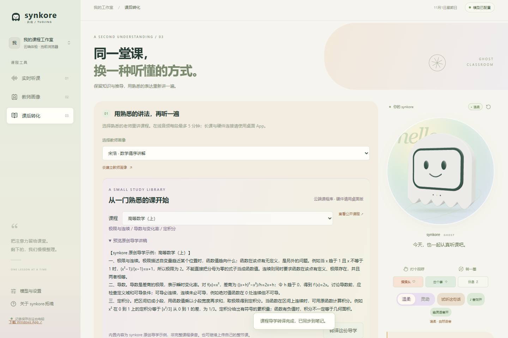

# synkore·拓境

**闵交幼儿园**的课程转译与软硬件探索作品。

- 杨放：前端、硬件与调试。
- 梁佳钰：后端。
- 目标：拓展与探索程序的实现能力，将课程转译、可交互的幽灵形象与外接开发板结合。

本仓库提供作品、源码和复现说明；团队的详细信息与工作总览另行提交。



## 直接体验

- **[打开在线 App](https://synkore-tuojing.azuremoon15.chatgpt.site)**：无需安装、无需填写 API 密钥。首次录音请允许浏览器使用麦克风。
- **[下载 Windows App](https://github.com/unfurlyang/synkore-tuojing/releases/latest)**：下载 ZIP 后完整解压，双击 `synkore.exe`。桌面版首次使用自己的 MiMo 配置；交付包不含开发者密钥。
- **[实际操作录屏](https://github.com/unfurlyang/synkore-tuojing/releases/download/v1.6.0/Synkore-Tuojing-demo.mp4)**（约两分钟，画面录屏）
- **[3 分钟体验流程](docs/DEMO.md)** · **[部署与复现](docs/RUNNING.md)** · **[第三方来源](THIRD_PARTY_NOTICES.md)**

## 三项核心功能

1. **实时听课**：录音或输入课程文字，清理无信息的口头词与重复，保留知识、数值和条件，逐段形成笔记。
2. **教师画像**：通过讲课文字或音频建立表达规则；内置一数、宋浩、李永乐三套公开资料启发的讲解方案，可查看来源。它们不是教师本人制作或授权，也不包含本人音色。
3. **课后转译**：用选定画像重述课程，支持对照原文、保存笔记；内置高数上下、线代、概率统计、大学物理、Python 六门原创导学示例及公开课程入口。

小幽灵支持 3D 拖动旋转、触摸反馈、六种表情、温柔／灵动语音与三秒粒子入场。涂鸦 T5 板保留触摸、KEY 控制和独立互动窗口。

## 目录

```text
cloud/                  云端 Worker API、公开课程数据与测试
desktop/frontend/       Web 与 Windows 共用的 3D 前端
desktop/backend/        Python / FastAPI 后端与回归测试
desktop/electron/       Windows 桌面壳、加密配置与本机服务管理
firmware/               涂鸦 T5 2.2.0 固件项目源码
docs/                   启动、使用、硬件协议和演示说明
docs/ci/                可选的 GitHub Actions 构建模板
```

在线版音频每段最多 5 分钟，上传音频在浏览器转换为 16kHz 单声道 WAV；长课和实体开发板连接请使用 Windows 版。在线模型设有每日体验额度，额度用尽会明确提示，不会展示伪造结果。云端默认先返回文字，实时听课可勾选自动播报。

内置导学是原创短讲稿，**不是完整课程视频或教师官方讲稿**。公式、数值和条件受保守检查；未通过检查的段落保留原文并提示，检查不代表数学正确性的自动证明。

评审可先打开在线 App，无硬件也能体验三项核心功能；实体板的局域网连接通过 Windows 本机服务完成，云端页面不宣称远程控制评审者未连接的开发板。

## 源码启动

Node.js 24、Python 3.12；完整步骤见 [RUNNING.md](docs/RUNNING.md)。

```bash
npm ci
npm ci --prefix desktop
npm test
npm run build
```

运行云端服务还需 D1、R2 及服务端秘密配置；Windows 版可从 UI 填写自己的 MiMo 密钥。源码、Release 包不包含开发者密钥、Wi-Fi 密码、配对令牌或私人录音。

本仓库公开用于作品评审与复现；原创代码的其他授权范围由作者另行决定。第三方组件遵循各自许可证。
